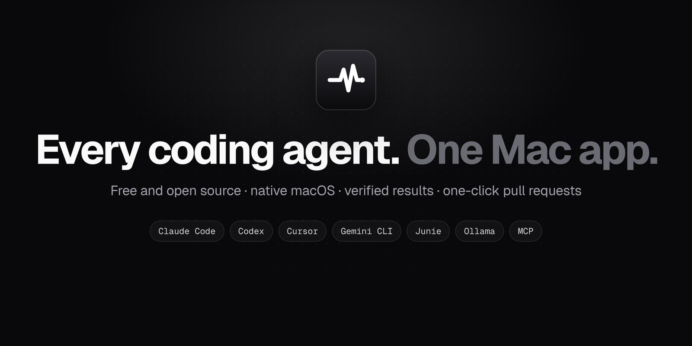
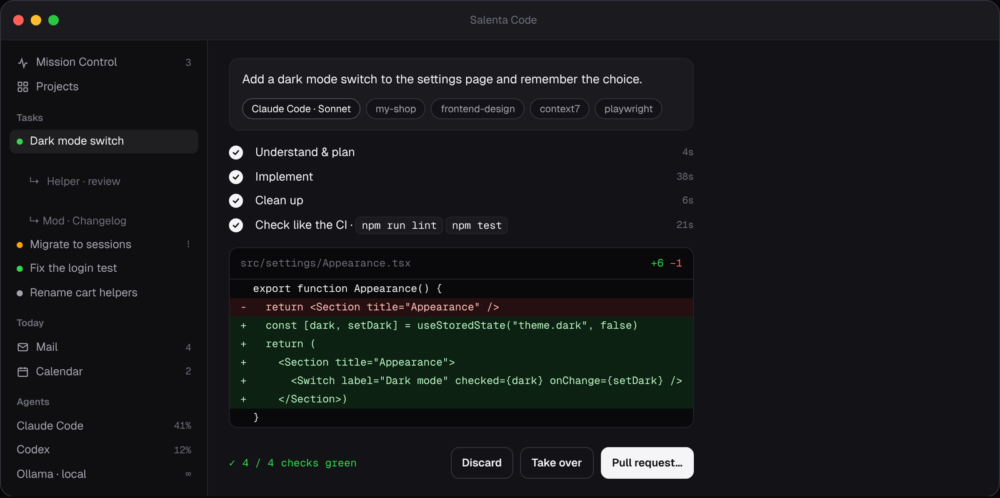

<p align="center">
  
</p>

<p align="center">
  <b>Der kostenlose Open-Source-Arbeitsplatz für KI-Coding-Agents auf dem Mac.</b><br>
  Claude Code, Codex, Cursor, Gemini CLI, Junie und lokale Modelle in einer ruhigen, nativen App –<br>
  mit eigener Arbeitskopie pro Auftrag, Prüfungen wie in deiner CI und Pull Requests mit einem Klick.
</p>

<p align="center">
  <a href="https://github.com/salenta-code/salenta-code/releases/latest/download/Salenta-Code.dmg"><b>Für Mac laden</b></a> ·
  <a href="https://salenta-code.github.io/salenta-code/">Website</a> ·
  <a href="docs/HILFE.md">Hilfe</a> ·
  <a href="README.md">English</a>
</p>

<p align="center">
  
</p>

## Warum Salenta Code?

Coding-Agents sind großartig – bis fünf davon in fünf Terminals laufen und du den Überblick verlierst.
Salenta Code holt sie in ein Fenster:

- **Schreib, was passieren soll.** Salenta Code wählt den passenden Agent, das Modell, das Projekt und nützliche Skills – oder du wählst selbst.
- **Jeder Auftrag arbeitet in einer eigenen Kopie** (git worktree). Dein Projekt bleibt unberührt, bis du übernimmst.
- **Geprüft, bevor du übernimmst.** Build, Lint, Tests und ein Review durch ein zweites Modell – dieselben Befehle wie in deiner CI.
- **Ein Klick zum Pull Request** – Titel, Beschreibung und Changelog werden für dich geschrieben.
- **Fragen, ohne etwas zu ändern.** Im Modus *Fragen* liest der Agent deinen Code und antwortet mit Datei- und Zeilenangaben.
- **Nativ und lokal.** SwiftUI, macOS 14+, Deutsch und Englisch. Deine Logins und Daten bleiben auf deinem Mac.

## Funktionen

| | |
|---|---|
| **Salenta Intelligence** | Die Schicht zwischen dir und deinen Agents, läuft auf deinem Mac: prüfbares „Fertig, wenn …“ für jeden Auftrag, ein Supervisor für hängende Agents, Trefferquote pro Agent, Vertrauen, das pro Projekt wächst, Lernen über Nacht und eine Mitteilungs-Zentrale mit Ruhezeit und Morgen-Briefing. |
| **Mission Control** | Alle laufenden Agents auf einem Bildschirm: was sie tun, wie voll ihr Kontext ist, welche Werkzeuge aktiv sind. |
| **Automatische Auswahl** | Bauen → Claude Code, Fehlersuche → Junie, Review → Codex, Kleinigkeiten → lokales Modell. Ist ein Limit erreicht, übernimmt der nächste. |
| **Fragen oder Bauen** | *Fragen* läuft nur lesend und antwortet mit `Datei:Zeile`. *Bauen* setzt den Auftrag um. Fragen werden automatisch erkannt. |
| **Prüfschleife** | Nach jedem Auftrag: Build, Lint, Tests, Screenshot bei UI-Änderungen und Review durch ein zweites Modell. Rot? Mit einem Klick beheben lassen. |
| **Pull Requests** | Committen, pushen und PR öffnen – mit fertigem Titel, Beschreibung und Changelog. Spätere Änderungen landen im selben PR. |
| **Projekte** | Eine Karte pro Repo: worum es geht, was gerade passiert, Branch, Änderungen, CI, offene PRs – jeder rote Zustand erklärt sich und hat einen Knopf zum Beheben. |
| **Freigaben** | Lesen und Testen laufen frei; `git push`, Löschen, Deploys und Datenbanken warten auf dich. Harte Sperr-Regeln pro Projekt. |
| **Parallel & Pläne** | Erst planen, dann bauen. Oder einen Auftrag an 2–3 Agents geben und das beste Ergebnis nehmen. Zurück zu jedem Checkpoint. |
| **Sitzungen bleiben** | Mit `tmux` arbeiten Agents weiter, wenn die App zu ist, und sind beim Start wieder da. |
| **MCP & Erweiterungen** | Übernimmt MCP-Server aus Claude Code, Codex, Cursor u. a.; Katalog mit Ein-Klick-Installation für ausgewählte Plugins und Skills. |
| **Lokal & offline** | Ollama-Modelle für kleine Aufgaben oder alles – automatischer Wechsel, wenn das Internet weg ist. |
| **Arbeitsplatz** | Apple Mail und Kalender nativ, Aufgaben, Notizen (optional mit Obsidian), Verbrauch und Limits pro Agent, Menüleiste und Widgets. |

## Installation

**Download:** [aktuelle DMG](https://github.com/salenta-code/salenta-code/releases/latest/download/Salenta-Code.dmg) öffnen
und **Salenta Code** in *Programme* ziehen. Die App ist von Apple signiert und beglaubigt und aktualisiert sich selbst.

**Aus dem Quellcode:** macOS 14+ und die Command Line Tools (`xcode-select --install`).

```bash
git clone https://github.com/salenta-code/salenta-code.git
cd salenta-code
./Install.command        # oder im Finder doppelklicken
```

Beim ersten Start erkennt eine kurze Einrichtung deine Agent-CLIs, MCP-Server und Chrome und verbindet Mail und Kalender.
Alles lässt sich später in den Einstellungen (⌘,) ändern. Die unterstützten Agents und ihre Installation stehen in der
[englischen README](README.md#supported-agents).

## Datenschutz

- Kein Konto, keine Telemetrie, kein Server von uns dazwischen. Salenta Code spricht nur mit den Agents und Diensten, die du verbindest.
- Schlüssel und Tokens liegen im macOS-Schlüsselbund, Aufträge und Einstellungen in `~/Library/Application Support`.
- Salenta Code sieht deine Agent-Logins nicht, gibt sie nicht weiter und verkauft keinen Zugang zu Modellen.
  Es gelten die Bedingungen des jeweiligen Anbieters. Für Teams empfehlen wir API-Schlüssel (Einstellungen › Modelle).

## Mitmachen

Issues und Pull Requests sind willkommen – siehe [CONTRIBUTING.md](CONTRIBUTING.md).
Sicherheitslücke gefunden? Bitte zuerst [SECURITY.md](SECURITY.md) lesen.

## Lizenz

[Apache 2.0](LICENSE). Siehe [NOTICE](NOTICE). Salenta Code steht in keiner Verbindung zu Anthropic, OpenAI, Google,
JetBrains, Cursor oder Ollama; Produktnamen sind Marken ihrer Inhaber.
