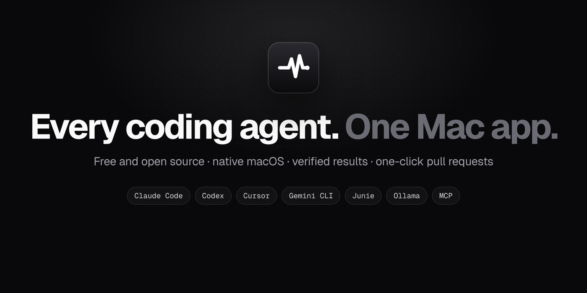
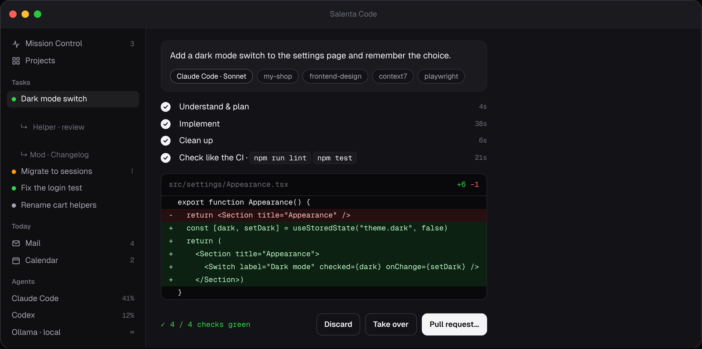
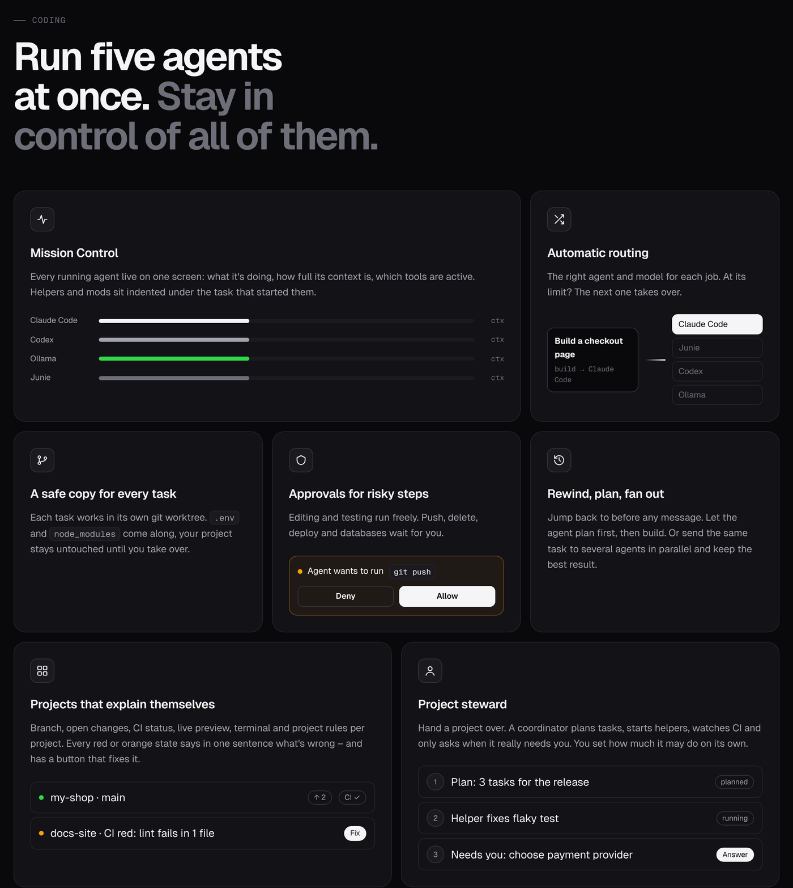
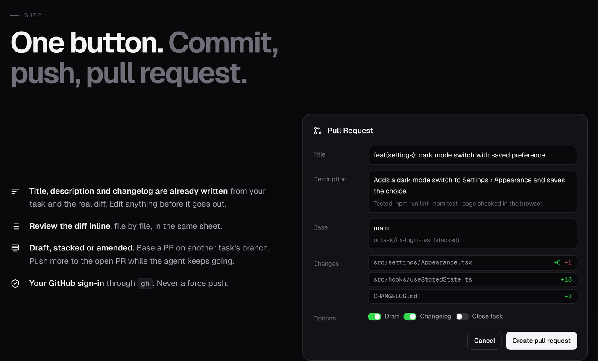
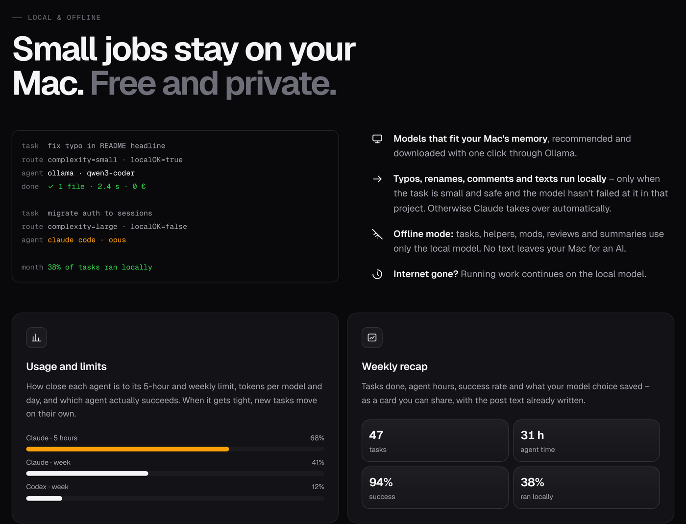

<p align="center">
  
</p>

<p align="center">
  <a href="https://github.com/salenta-code/salenta-code/releases/latest"></a>
  <a href="https://github.com/salenta-code/salenta-code/actions/workflows/ci.yml"></a>
  
  
  <a href="LICENSE"></a>
  <a href="https://github.com/salenta-code/salenta-code/stargazers"></a>
</p>

<p align="center">
  <b>The free, open-source Mac workspace for AI coding agents.</b><br>
  Claude Code, Codex, Cursor, Gemini CLI, Junie and local models in one calm, native app –<br>
  with a safe copy for every task, checks like your CI and one-click pull requests.
</p>

<p align="center">
  <a href="https://github.com/salenta-code/salenta-code/releases/latest/download/Salenta-Code.dmg"><b>Download for Mac</b></a> ·
  <a href="https://salenta-code.github.io/salenta-code/">Website</a> ·
  <a href="docs/HELP.md">Help</a> ·
  <a href="README.de.md">Deutsch</a>
</p>

<p align="center">
  
</p>

## Why Salenta Code?

Coding agents are great – until you run five of them in five terminals and lose track of what each one is doing.
Salenta Code puts them in one window:

- **Write what should happen.** Salenta Code picks the right agent and model, the matching project and the useful skills – or you choose yourself.
- **Every task works in its own copy** (git worktree). Your project stays untouched until you apply the changes.
- **Checked before you merge.** Build, lint, tests and a review by a second model – the same commands your CI runs.
- **One click to a pull request** with title, description and changelog written for you.
- **Ask without changing anything.** Switch to *Ask* and the agent reads your code and answers – with file and line references.
- **Native and local.** SwiftUI, macOS 14+, English and German. Your sign-ins and data stay on your Mac.

## Features



| | |
|---|---|
| **Mission Control** | Every running agent on one screen: what it is doing, how full its context is, which tools are active. |
| **Automatic routing** | Building → Claude Code, debugging → Junie, review → Codex, small edits → local model. At a limit, the next agent takes over. |
| **Ask or build** | *Ask* runs read-only and answers with `file:line` references. *Build* carries out the task. Questions are detected automatically. |
| **Verification loop** | After each task: build, lint, tests, a screenshot of UI changes and a second-model review. Red? Let it fix itself with one click. |
| **Pull requests** | Commit, push and open a PR with a generated title, description and changelog. Follow-up changes land in the same PR. |
| **Projects** | One card per repo: what it is about, what is happening now, branch, changes, CI, open PRs – every red state explains itself and has a fix button. |
| **Approvals** | Reading and testing run freely; `git push`, deleting, deploys and databases wait for you. Hard block rules per project. |
| **Parallel & plans** | Plan first, then build. Or send one task to 2–3 agents and keep the best result. Rewind to any checkpoint. |
| **Persistent sessions** | With `tmux`, agents keep working when the app is closed and reattach on start. |
| **MCP & extensions** | Imports MCP servers from Claude Code, Codex, Cursor and more; a catalog with one-click install for curated plugins and skills. |
| **Local & offline** | Ollama models for small tasks or everything – automatic fallback when the internet drops. |
| **Workspace** | Native Apple Mail and Calendar, tasks, notes (optional Obsidian vault), usage and limits per agent, menu bar and widgets. |



## Supported agents

Salenta Code starts the official command-line tools on your Mac – each with your own sign-in or API key.
Install the ones you use; they are detected automatically.

| Agent | Install | Sign in |
|---|---|---|
| Claude Code | `curl -fsSL https://claude.ai/install.sh \| bash` | `claude auth login` |
| Codex | `npm i -g @openai/codex` | `codex login` |
| Cursor | `curl https://cursor.com/install -fsS \| bash` | `cursor-agent login` |
| Gemini CLI | `npm i -g @google/gemini-cli` | on first start |
| OpenCode | `curl -fsSL https://opencode.ai/install \| bash` | `opencode auth login` |
| Kiro | `curl -fsSL https://cli.kiro.dev/install \| bash` | `kiro-cli login` |
| Junie | see [junie.jetbrains.com](https://junie.jetbrains.com) | |
| Ollama (local) | [ollama.com](https://ollama.com) | – |

Open-source models (Qwen, DeepSeek, Kimi, GLM …) also work through OpenRouter.

## Install

**Download:** grab the [latest DMG](https://github.com/salenta-code/salenta-code/releases/latest/download/Salenta-Code.dmg),
open it and drag **Salenta Code** into *Applications*. The app is signed and notarized by Apple and updates itself.

**Build from source:** requires macOS 14+ and the Command Line Tools (`xcode-select --install`).

```bash
git clone https://github.com/salenta-code/salenta-code.git
cd salenta-code
./Install.command        # or double-click it in Finder
```

On first start a short setup detects your agent CLIs, MCP servers and Chrome, and connects mail and calendar.
Everything can be changed later in Settings (⌘,).



## Privacy

- No account, no telemetry, no server of ours in between. Salenta Code talks only to the agents and services you connect.
- Keys and tokens live in the macOS Keychain. Your tasks and settings stay in `~/Library/Application Support`.
- Salenta Code never sees or forwards your agent sign-ins and does not resell access to any model.
  Each provider's terms apply to how you use their tool. For teams we recommend API keys (Settings › Models).

## How it fits together

| Path | What it is |
|---|---|
| `App/` | The SwiftUI app (Swift package, built with `App/build.sh`) |
| `bin/aos-mcp` | Salenta Code as an MCP server for agents: tasks, calendar, mail, approvals, delegation |
| `bin/aos-live` | Turns agent output into readable live steps |
| `bin/aos` | Small task CLI for you and your agents |
| `website/` | The project website (GitHub Pages) |
| `AGENTS.md` | Rules every agent reads when working on this repo |

## Contributing

Issues and pull requests are welcome – see [CONTRIBUTING.md](CONTRIBUTING.md).
Found a security problem? Please read [SECURITY.md](SECURITY.md) first.

## License

[Apache 2.0](LICENSE). See [NOTICE](NOTICE). Salenta Code is not affiliated with Anthropic, OpenAI, Google, JetBrains,
Cursor or Ollama; product names are trademarks of their owners.
